# Mob Control loadout image catalog

**42 individual card images** extracted from four armory screenshots on November 2, 2026.

This is a 42-card image inventory with a **leader-selected two-row starter matrix** in `recommended-loadouts.json`. Do not infer any additional strategies or endorsements.
All images are direct crops of the user-provided in-game card artwork; no AI re-creations.
The visible card levels and rarity badges are snapshot details, not a source of current player levels.

Use `catalog.json` for machine-readable IDs, names, image paths, screenshot coordinates, and slot categories.
Use `catalog.csv` for spreadsheet imports. Categories are `cannons`, `mobs`, `champions`, `ultimates`.

## Inventory

### Cannons (11)

| Image | Name | ID |
| --- | --- | --- |
| 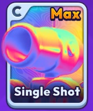 | Single Shot | `cannon:single-shot` |
| 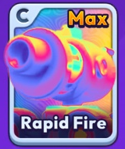 | Rapid Fire | `cannon:rapid-fire` |
| 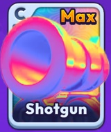 | Shotgun | `cannon:shotgun` |
| 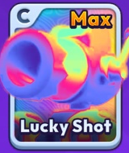 | Lucky Shot | `cannon:lucky-shot` |
| 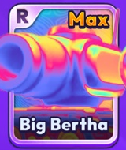 | Big Bertha | `cannon:big-bertha` |
| 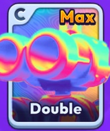 | Double | `cannon:double` |
| 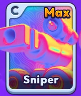 | Sniper | `cannon:sniper` |
| 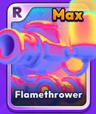 | Flamethrower | `cannon:flamethrower` |
| 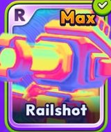 | Railshot | `cannon:railshot` |
| 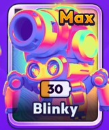 | Blinky | `cannon:blinky` |
| 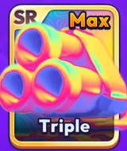 | Triple | `cannon:triple` |

### Mobs (12)

| Image | Name | ID |
| --- | --- | --- |
| 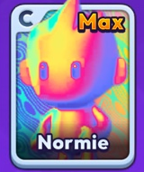 | Normie | `mob:normie` |
| 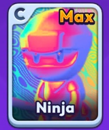 | Ninja | `mob:ninja` |
| 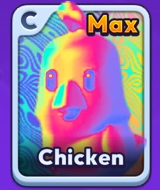 | Chicken | `mob:chicken` |
| 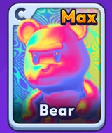 | Bear | `mob:bear` |
| 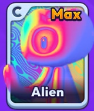 | Alien | `mob:alien` |
| 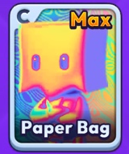 | Paper Bag | `mob:paper-bag` |
| 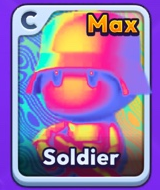 | Soldier | `mob:soldier` |
| 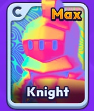 | Knight | `mob:knight` |
| 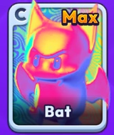 | Bat | `mob:bat` |
| 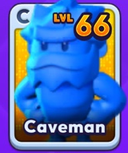 | Caveman | `mob:caveman` |
| 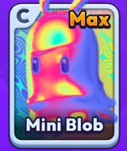 | Mini Blob | `mob:mini-blob` |
| 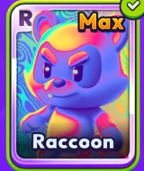 | Raccoon | `mob:raccoon` |

### Champions (10)

| Image | Name | ID |
| --- | --- | --- |
| 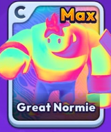 | Great Normie | `champion:great-normie` |
| 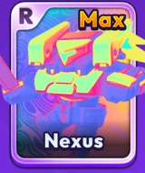 | Nexus | `champion:nexus` |
| 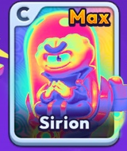 | Sirion | `champion:sirion` |
| 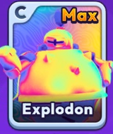 | Explodon | `champion:explodon` |
| 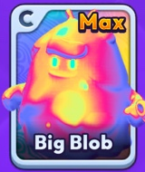 | Big Blob | `champion:big-blob` |
| 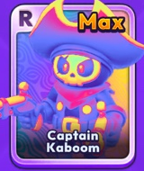 | Captain Kaboom | `champion:captain-kaboom` |
| 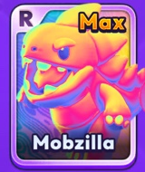 | Mobzilla | `champion:mobzilla` |
| 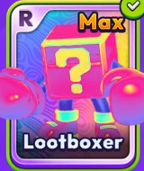 | Lootboxer | `champion:lootboxer` |
| 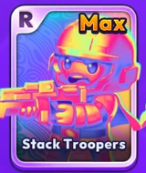 | Stack Troopers | `champion:stack-troopers` |
| 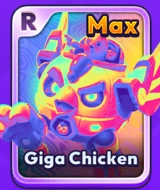 | Giga Chicken | `champion:giga-chicken` |

### Ultimates (9)

| Image | Name | ID |
| --- | --- | --- |
| 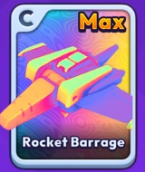 | Rocket Barrage | `ultimate:rocket-barrage` |
| 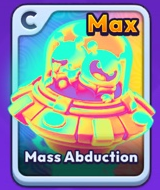 | Mass Abduction | `ultimate:mass-abduction` |
| 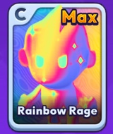 | Rainbow Rage | `ultimate:rainbow-rage` |
| 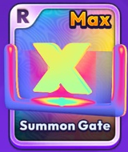 | Summon Gate | `ultimate:summon-gate` |
| 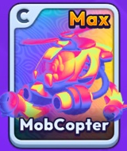 | MobCopter | `ultimate:mobcopter` |
| 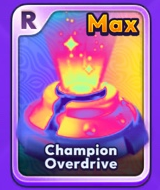 | Champion Overdrive | `ultimate:champion-overdrive` |
| 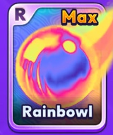 | Rainbow1 | `ultimate:rainbow1` |
| 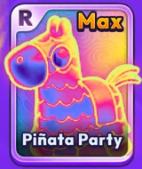 | Piñata Party | `ultimate:pinata-party` |
| 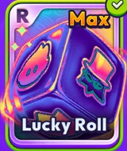 | Lucky Roll | `ultimate:lucky-roll` |

## Source and use notes

- The four source screenshots were supplied directly by the AVENGERS commissioner.
- The crop rectangle and source screenshot filename for each card are recorded in `catalog.json`.
- `Rainbow1` is transcribed as displayed on its screenshot; confirm the game label if used as a public-facing recommendation.
- For loadout recommendations, reference the stable IDs rather than hardcoding filenames.
- No strategy ratings, recommended pairings, account upgrades, or event-specific rules have been assigned yet.

## Leader-selected matrix starter

| INTENDED PURPOSE | CANNON | MOB | CHAMPION | ULTIMATE |
|---|---|---|---|---|
| Piggy with GigaChicken | Single Shot (7.3 s) | Chicken | Giga Chicken | Champion Overdrive |
| Space Race | Big Bertha (9.0 s) | Raccoon | Explodon | Summon Gate |

## Cannon timings (seconds, one decimal)

| Cannon | Time |
|---|---:|
| Single Shot | 7.3 |
| Rapid Fire | 7.9 |
| Shotgun | 8.5 |
| Lucky Shot | 9.6 |
| Big Bertha | 9.0 |
| Double | 9.5 |
| Sniper | 9.3 |
| Railshot | 9.7 |
| Flamethrower | 11.1 |
| Triple | 10.5 |
| Blinky | 10.5 |

The leader explicitly overrode Big Bertha, Triple, and Blinky; original timing screenshot otherwise rounded to one decimal place. Machine-readable values live in `catalog.json` and the selected rows are in `recommended-loadouts.json`.
